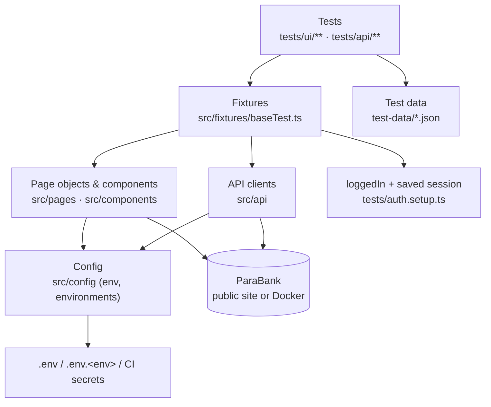

# ParaBank UI + API Automation

[](https://github.com/harimandadi/parabank-ui-api-automation/actions/workflows/playwright.yml)

End-to-end test automation framework for the [ParaBank](https://parabank.parasoft.com/parabank/index.htm) demo banking application, built with **Playwright + TypeScript**. It covers the UI and the REST API, runs locally, in Docker and in GitHub Actions, and produces Playwright HTML and Allure reports.

---

## Table of contents

1. [Features](#features)
2. [Tech stack](#tech-stack)
3. [Architecture](#architecture)
4. [Project structure](#project-structure)
5. [Prerequisites](#prerequisites)
6. [Setup (step by step)](#setup-step-by-step)
7. [Configuration](#configuration)
8. [Running tests](#running-tests)
9. [Running in Docker](#running-in-docker)
10. [Reports](#reports)
11. [CI/CD with GitHub Actions](#cicd-with-github-actions)
12. [Test coverage](#test-coverage)
13. [Writing a new test](#writing-a-new-test)
14. [AI test agents (planner, generator, healer)](#ai-test-agents-planner-generator-healer)
15. [Design decisions](#design-decisions)
16. [Troubleshooting](#troubleshooting)

---

## Features

| Area | What the framework does |
|---|---|
| **Page Object Model** | Pages in `src/pages`, shared UI parts in `src/components`, all locators kept out of the tests |
| **Custom fixtures** | Page objects, API clients and a `loggedIn` state injected into tests via `src/fixtures/baseTest.ts` |
| **UI + API** | Browser tests and REST API tests in one framework, sharing config and data |
| **Log in once** | A `setup` project logs in a single time and saves the session (`storageState`); Account Services tests reuse it |
| **Environments** | `TEST_ENV=local \| qa \| staging \| prod`, each with its own URL, worker count and safety rules |
| **Secrets management** | Credentials from `.env` (git-ignored) locally and GitHub Secrets in CI; none in code |
| **Prod safety** | Tests tagged `@creates-account` / `@modifies-data` are skipped automatically on `prod` |
| **Docker** | Tests run in the official Playwright image against a private ParaBank container |
| **Reporting** | Playwright HTML report + Allure (business-level steps, Epic/Feature/Story, failure categories, trend history) |
| **Failure evidence** | Screenshot and full trace for every failure; video on retries |
| **CI** | GitHub Actions in a Playwright container, environment picker, report artifacts |
| **AI agents** | Playwright test planner / generator / healer agents for Claude Code |

---

## Tech stack

| Tool | Purpose |
|---|---|
| [Playwright Test](https://playwright.dev) 1.65 | Browser automation, API testing, test runner |
| TypeScript | Typed test code |
| dotenv | Loads `.env` files |
| cross-env | Sets environment variables in npm scripts on any OS |
| allure-playwright + allure-commandline | Allure reporting |
| Docker / Docker Compose | Containerised test runs and a private ParaBank |
| GitHub Actions | Continuous integration |

---

## Architecture



**Layers**

1. **Tests** describe *what* is checked, in business language.
2. **Fixtures** create page objects and API clients and put the browser into the right state (for example, already logged in).
3. **Page objects / API clients** know *how* to talk to the application: locators, clicks, HTTP calls. Each important action is wrapped in `test.step()` so reports read like a test case.
4. **Config** decides *where* to run (URL, workers, credentials) based on `TEST_ENV`.

---

## Project structure

```
parabank-ui-api-automation/
├── .claude/agents/            Playwright AI agents (planner, generator, healer)
├── .github/workflows/         GitHub Actions pipeline (playwright.yml)
├── scripts/
│   ├── allure-report.mjs      Builds the Allure report and keeps trend history
│   └── wait-for-url.mjs       Waits until ParaBank is up (used by Docker)
├── specs/                     Test plans written by the planner agent
├── src/
│   ├── api/                   API clients (LoginApi)
│   ├── components/            Shared UI parts (AccountServicesMenu)
│   ├── config/
│   │   ├── env.ts             Loads .env files, exposes ENV (URL, credentials, workers)
│   │   ├── environments.ts    local / qa / staging / prod definitions
│   │   └── auth.ts            Path of the saved login session
│   ├── fixtures/baseTest.ts   Custom fixtures, loggedIn, automatic Allure labels
│   ├── pages/                 Page objects (Login, Register, Transfer Funds, ...)
│   └── utils/                 Helpers (dates, unique amounts, random strings)
├── test-data/                 JSON test data and expected messages
├── tests/
│   ├── auth.setup.ts          Logs in once and saves the session
│   ├── seed*.spec.ts          Starting points for the AI agents
│   ├── api/login/             API tests
│   └── ui/
│       ├── login/             Login UI tests
│       ├── register/          Registration UI tests
│       └── account-services/  Menu, Transfer Funds, Find Transactions
├── .env.example               Template for local settings and credentials
├── Dockerfile                 Test-runner image
├── docker-compose.yml         ParaBank + test runner
└── playwright.config.ts       Projects, reporters, workers, environment rules
```

---

## Prerequisites

| Tool | Version | Needed for |
|---|---|---|
| [Node.js](https://nodejs.org) | 20 or newer (22 LTS recommended) | Everything |
| npm | comes with Node.js | Installing packages |
| [Git](https://git-scm.com) | any recent | Cloning the repo |
| Java (JRE/JDK) | 11 or newer | Building the **Allure** report only |
| [Docker Desktop](https://www.docker.com/products/docker-desktop) | any recent | **Docker** runs only (optional) |

Check what you have:

```bash
node -v
npm -v
java -version
docker --version
```

---

## Setup (step by step)

**Step 1: Clone the repository**

```bash
git clone https://github.com/harimandadi/parabank-ui-api-automation.git
cd parabank-ui-api-automation
```

**Step 2: Install dependencies**

```bash
npm ci
```

**Step 3: Install the Playwright browser**

```bash
npx playwright install chromium
```

Use `npx playwright install` (no argument) if you also want Firefox and WebKit.

**Step 4: Create your `.env` file**

Copy the template:

```bash
cp .env.example .env
```

On Windows PowerShell:

```powershell
Copy-Item .env.example .env
```

Then open `.env` and fill in the values:

```dotenv
TEST_ENV=qa
PARABANK_USERNAME=john
PARABANK_PASSWORD=demo
PARABANK_REGISTER_USERNAME=john123
PARABANK_REGISTER_PASSWORD=<any password for newly registered test users>
```

`john / demo` is ParaBank's built-in demo user. `.env` is git-ignored, so it is never committed.

**Step 5: Run the tests**

```bash
npm test
```

**Step 6: Open the report**

```bash
npm run report
```

---

## Configuration

### Environment variables

| Variable | Required | Default | Description |
|---|---|---|---|
| `TEST_ENV` | no | `qa` | Target environment: `local`, `qa`, `staging`, `prod` |
| `BASE_URL` | no | from `environments.ts` | Override the environment's URL |
| `PARABANK_USERNAME` | **yes** | none | Existing user for login and Account Services tests |
| `PARABANK_PASSWORD` | **yes** | none | Password for that user |
| `PARABANK_REGISTER_USERNAME` | no | `john123` | Prefix for newly registered users (a unique suffix is added) |
| `PARABANK_REGISTER_PASSWORD` | **yes** | none | Password given to newly registered users |
| `WORKERS` | no | per environment | Number of parallel workers |
| `ALL_BROWSERS` | no | off | `1` adds Firefox and WebKit to Chromium |
| `PW_AGENTS` | no | off | `1` includes the agent seed tests (set automatically for the agents) |

### Where values come from (highest priority first)

1. Real environment variables (your terminal, CI secrets)
2. `.env.<TEST_ENV>`, e.g. `.env.staging` (optional, git-ignored)
3. `.env`
4. Defaults in `src/config/environments.ts`

If a required variable is missing, the test stops with a clear message such as *"Missing PARABANK_PASSWORD. Add it to .env (see .env.example)…"*.

### Environments

Defined in [`src/config/environments.ts`](src/config/environments.ts):

| `TEST_ENV` | URL | Workers | Data-changing tests |
|---|---|---|---|
| `local` | `http://127.0.0.1:8080` (Docker ParaBank) | 4 | run |
| `qa` | `https://parabank.parasoft.com` | 2 | run |
| `staging` | `https://parabank.parasoft.com` | 2 | run |
| `prod` | `https://parabank.parasoft.com` | 2 | **skipped** |

ParaBank has only one public instance, so `qa`, `staging` and `prod` share a URL for now. To point an environment somewhere else, change its `baseUrl` or set `BASE_URL` in `.env.<env>`.

### Setting a variable for one run

PowerShell:

```powershell
$env:TEST_ENV="staging"; npm test
```

Bash / Git Bash / macOS / Linux:

```bash
TEST_ENV=staging npm test
```

---

## Running tests

### npm scripts

| Command | What it runs |
|---|---|
| `npm test` | All tests, current `TEST_ENV` (default `qa`), Chromium |
| `npm run test:ui` | UI tests only |
| `npm run test:api` | API tests only |
| `npm run test:login` | Login UI + API tests |
| `npm run test:register` | Registration tests |
| `npm run test:account-services` | Account Services tests |
| `npm run test:local` | All tests against a local Docker ParaBank |
| `npm run test:qa` / `test:staging` / `test:prod` | All tests against that environment |
| `npm run test:all-browsers` | Chromium + Firefox + WebKit, one worker |

### Useful Playwright options

Add them after `--` when using npm scripts, e.g. `npm test -- --headed`.

| Goal | Command |
|---|---|
| One file | `npx playwright test tests/ui/login/login.spec.ts` |
| One test by name | `npx playwright test -g "invalid credentials"` |
| See the browser | `npx playwright test --headed` |
| Interactive UI mode | `npx playwright test --ui` |
| Step-by-step debugger | `npx playwright test --debug` |
| Skip account-creating tests | `npx playwright test --grep-invert "@creates-account"` |
| List tests without running | `npx playwright test --list` |
| Record a new flow / find locators | `npx playwright codegen https://parabank.parasoft.com/parabank/index.htm` |

### Test tags

| Tag | Meaning |
|---|---|
| `@creates-account` | Registers a new user |
| `@modifies-data` | Makes a transfer or otherwise changes data |

Both are skipped automatically when `TEST_ENV=prod`.

### Rate limits on the public site

The public ParaBank is behind Cloudflare, which blocks bursts of traffic (Error 1015 / HTTP 429). The defaults keep the load low: Chromium only, 2 workers, and a single login per run. For heavy or parallel runs, use [Docker](#running-in-docker).

---

## Running in Docker

Docker gives you a **private ParaBank** with no rate limit and isolated data. Tests run in the official Playwright image, so no browser has to be installed on your machine.

**Step 1:** Start Docker Desktop.

**Step 2:** Run everything (ParaBank + tests):

```bash
npm run docker:test
```

This will:

1. Start a ParaBank container (`parasoft/parabank`).
2. Build the test image from the `Dockerfile`.
3. Wait until ParaBank is ready.
4. Run all tests with 4 workers.
5. Copy `playwright-report/`, `allure-results/` and `test-results/` back to your project folder.

The first run downloads the images and takes a few minutes. Later runs take about 30 seconds.

**Step 3:** Open the reports as usual (`npm run report`, `npm run allure:report`).

### Other Docker commands

| Command | What it does |
|---|---|
| `npm run docker:parabank` | Start only ParaBank on http://localhost:8080/parabank and wait until ready |
| `npm run test:local` | Run tests from your machine against that container |
| `docker compose run --rm tests` | Run the test container again (ParaBank already running) |
| `npm run docker:down` | Stop and remove the containers |

Change the worker count with `WORKERS=6 docker compose run --rm tests`.

The private ParaBank includes the default `john / demo` user, so the same `.env` works. Its data resets whenever the container is recreated.

---

## Reports

Every run produces both reports.

### Playwright HTML report

```bash
npm run report
```

This shows each test with its steps, errors, screenshots and a **trace** (a full timeline you can step through). To open a trace on its own:

```bash
npx playwright show-trace test-results/<test-folder>/trace.zip
```

### Allure report

Requires Java.

```bash
npm run allure:report
```

This builds the report from `allure-results/` and opens it in your browser. It includes:

- **Behaviors**: tests grouped by Epic → Feature → Story, taken automatically from the folder (`tests/ui/account-services/transfer-funds.spec.ts` → UI › Account Services › Transfer Funds).
- **Steps**: business-level steps such as *"Transfer $47.83 from account 12345 to 54321"*.
- **Categories**: failures grouped as rate limited, login/credentials problem, timeouts, assertion failures, or test code errors.
- **Environment**: environment name, URL, browsers, Node.js version, OS.
- **Trend history**: kept across runs by `scripts/allure-report.mjs`.

`allure:generate` builds two versions:

| Folder | How to view | Notes |
|---|---|---|
| `allure-report/` | `npm run allure:open` (starts a local server) | Includes trend history. Opening its `index.html` directly shows **"500 Failed to fetch"** |
| `allure-report-single/index.html` | **Double-click** it | Everything in one file. This is the version CI uploads |

Other Allure commands:

| Command | What it does |
|---|---|
| `npm run allure:generate` | Build both reports (keeps history) |
| `npm run allure:open` | Open the last built report |
| `npm run allure:serve` | Build a temporary report and open it |

### Failure evidence

| Evidence | When |
|---|---|
| Screenshot | Every failure |
| Trace | Every failure |
| Video | Retries only (recording every test made runs about 50% slower) |

---

## CI/CD with GitHub Actions

The pipeline is in [`.github/workflows/playwright.yml`](.github/workflows/playwright.yml).

**When it runs**

- On every push to `main`
- On every pull request into `main`
- Manually, from the Actions tab, with an environment of your choice

**What it does**

1. Starts a job inside the `mcr.microsoft.com/playwright` image (browsers preinstalled).
2. Restores the npm cache and runs `npm ci`.
3. Runs the tests for the selected `TEST_ENV` (default `qa`).
4. Builds the Allure report.
5. Uploads `allure-report-<env>` (single-file, double-click to open) and `playwright-report-<env>` as artifacts (kept 30 days).

### One-time setup: add the secrets

1. Open the repository on GitHub, then **Settings → Secrets and variables → Actions**.
2. Click **New repository secret** and add:

   | Name | Value |
   |---|---|
   | `PARABANK_USERNAME` | `john` |
   | `PARABANK_PASSWORD` | `demo` |
   | `PARABANK_REGISTER_PASSWORD` | a password for newly registered test users |

To change a secret later, click the pencil icon next to it. GitHub never shows the old value.

### Running the pipeline manually

1. Go to **Actions → Playwright Tests**.
2. Click **Run workflow**.
3. Choose the branch and the environment (`qa`, `staging` or `prod`).
4. Click **Run workflow**.

### Getting the reports

1. Open a finished run and scroll to **Artifacts**.
2. Download and unzip `allure-report-<env>` or `playwright-report-<env>`.
3. **Allure:** double-click `index.html`. It is a single self-contained file, so no server is needed.
4. **Playwright HTML report:** open it from the project folder:

```bash
npx playwright show-report path/to/playwright-report-qa
```

---

## Test coverage

| Module | Type | Spec | Tests |
|---|---|---|---|
| Login | UI | `tests/ui/login/login.spec.ts` | Form elements · valid login + logout · invalid credentials · empty credentials |
| Login | API | `tests/api/login/login.api.spec.ts` | Valid credentials return the customer · invalid credentials return 400 |
| Register | UI | `tests/ui/register/register.spec.ts` | Form elements · required-field errors · password mismatch · new user registers and logs in · duplicate username rejected |
| Account Services menu | UI | `tests/ui/account-services/account-services-menu.spec.ts` | Welcome text + all menu links · links open their pages |
| Transfer Funds | UI | `tests/ui/account-services/transfer-funds.spec.ts` | Form elements · transfer + confirmation · transfer appears in Find Transactions |
| Find Transactions | UI | `tests/ui/account-services/find-transactions.spec.ts` | All search options · find by date and date range · invalid date validation |

There are **19 tests plus 1 setup step** (20 per Chromium run).

---

## Writing a new test

Example: adding **Bill Pay**.

**1. Create a page object:** `src/pages/BillPayPage.ts`

```ts
import { Locator, Page, test } from '@playwright/test';
import { BasePage } from './BasePage';

export class BillPayPage extends BasePage {
  readonly payeeNameInput: Locator;
  readonly sendPaymentButton: Locator;

  constructor(page: Page) {
    super(page);
    this.payeeNameInput = page.locator('input[name="payee.name"]');
    this.sendPaymentButton = page.getByRole('button', { name: 'Send Payment' });
  }

  async pay(payee: string): Promise<void> {
    await test.step(`Pay bill to "${payee}"`, async () => {
      await this.payeeNameInput.fill(payee);
      await this.sendPaymentButton.click();
    });
  }
}
```

**2. Register it as a fixture** in `src/fixtures/baseTest.ts`:

```ts
billPayPage: async ({ page }, use) => use(new BillPayPage(page)),
```

**3. Write the spec:** `tests/ui/account-services/bill-pay.spec.ts`

```ts
import { test, expect } from '../../../src/fixtures/baseTest';
import { AUTH_FILE } from '../../../src/config/auth';

test.use({ storageState: AUTH_FILE }); // start already logged in

test.describe('Account Services - Bill Pay', () => {
  test.beforeEach(async ({ loggedIn, accountServicesMenu }) => {
    await accountServicesMenu.open('Bill Pay');
  });

  test('pays a bill', { tag: '@modifies-data' }, async ({ billPayPage }) => {
    await billPayPage.pay('Electric Co');
    // assertions...
  });
});
```

**Conventions**

- Import `test` and `expect` from `src/fixtures/baseTest`, not from `@playwright/test`.
- Keep locators in page objects, never in specs.
- Never hardcode credentials. Use `ENV.username` / `ENV.password`.
- Tag tests that create or change data, so `prod` skips them.
- Use unique values (`uniqueAmount()`, unique usernames) so a test only finds its own data.

---

## AI test agents (planner, generator, healer)

The project includes Playwright's test agents for [Claude Code](https://claude.com/claude-code), in `.claude/agents/`:

| Agent | What it does |
|---|---|
| `playwright-test-planner` | Explores the app in a real browser and writes a test plan to `specs/` |
| `playwright-test-generator` | Turns each plan scenario into a `.spec.ts`, verifying every step live |
| `playwright-test-healer` | Runs tests, debugs failures and fixes locators or assertions |

**How to use them**

1. Open the project in Claude Code. Approve the `playwright-test` MCP server (from `.mcp.json`) when asked.
2. Ask, for example:
   - *"Use playwright-test-planner to create a test plan for Bill Pay using tests/seed-logged-in.spec.ts, save it to specs/bill-pay.plan.md"*
   - *"Use playwright-test-generator to generate tests from specs/bill-pay.plan.md"*
   - *"Use playwright-test-healer to run tests/ui/account-services and fix the failures"*

Seed files set the starting state:

- `tests/seed.spec.ts`: logged out
- `tests/seed-logged-in.spec.ts`: logged in

After a Playwright upgrade, regenerate the agents with `npm run agents:init`, then re-check the project-specific sections at the end of each agent file.

---

## Design decisions

| Decision | Why |
|---|---|
| **Log in once (`storageState`)** | UI login before every Account Services test meant 24 logins across 3 browsers. One setup login, reused everywhere, cut that to 1. It is faster and keeps the public site from rate-limiting the run. |
| **Fixture with a fallback login** | `loggedIn` opens Accounts Overview with the saved session. If the session has expired, it logs in through the UI, so tests never depend on a stale file. |
| **Secrets only in `.env` / CI secrets** | The repository is public. Missing secrets fail fast with a clear message. |
| **`TEST_ENV`, not `ENV`** | Some POSIX shells use `ENV` for their own start-up file. |
| **Per-environment workers** | The public site is rate-limited (2 workers). A private Docker instance can take 4. |
| **Reports written inside the container** | Writing into a Windows/OneDrive bind mount during the run made Docker runs about 3x slower. Reports are copied out once at the end. |
| **Video only on retries** | Recording every test added about 50% to run time. Traces already contain a screenshot timeline and cost almost nothing. |
| **`127.0.0.1` for local runs** | On Windows, `localhost` tries IPv6 first and adds a delay to every request. |
| **Self-contained data tests** | Tests create the data they need, with unique names and amounts, so they work on a fresh database and on the shared public one. |
| **Allure labels from folder paths** | Every new spec gets Epic/Feature/Story labels without extra code. |

---

## Troubleshooting

| Symptom | Cause | Fix |
|---|---|---|
| `Missing PARABANK_USERNAME` (or another variable) | No `.env`, or a CI secret is missing | Create `.env` from `.env.example`; in CI add the [secrets](#one-time-setup-add-the-secrets) |
| `Login failed for "john"` | Wrong credentials, or the public demo data was reset | Check `.env` / secrets; try logging in manually on the site |
| **Error 1015**, HTTP **429**, many timeouts | Cloudflare rate-limited the public site | Wait 10–15 minutes; use fewer workers (`WORKERS=1`) or run in [Docker](#running-in-docker) |
| `Unknown TEST_ENV "uat"` | Typo in the environment name | Use `local`, `qa`, `staging` or `prod` |
| `allure: command not found` / Java error | Java missing | Install Java 11+ and run `java -version` to check |
| Allure shows **"500 Failed to fetch"** or a blank page | Opened `allure-report/index.html` directly; browsers block `file://` reads | Open `allure-report-single/index.html` instead, or run `npm run allure:open` |
| `failed to connect to the docker API` | Docker Desktop not running | Start Docker Desktop and wait until it is ready |
| `Executable doesn't exist` (browser) | Browsers not installed locally | `npx playwright install chromium` |
| Tests pass locally but fail in CI | Missing secrets, or a rate limit on GitHub's IP | Check the run log; download the report artifacts |

---

## Author

[@harimandadi](https://github.com/harimandadi)
